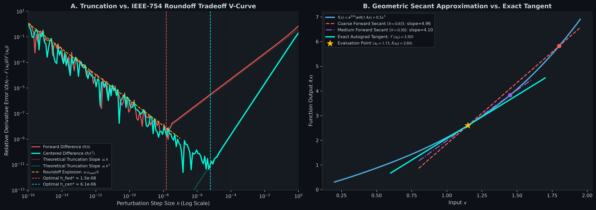
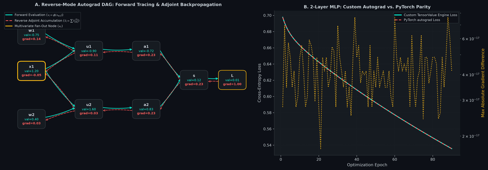

# Computation Graphs & Micro-Autograd from Scratch: Reverse-Mode Automatic Differentiation Engine

[](#)
[](#)
[](#)
[](#)

A pure from-scratch implementation of **Reverse-Mode Automatic Differentiation (Autograd)** in Python and NumPy. Features a dynamic Directed Acyclic Graph (DAG) tracer, topological sorting, operator overloading, and N-dimensional tensor broadcasting un-reduction with exact $`< 10^{-14}`$ machine-precision parity against PyTorch `torch.autograd`.

---

## Table of Contents
1. [Physical Intuition & Mental Models](#1-physical-intuition--mental-models)
2. [Mathematical Formulations & Rigorous Derivations](#2-mathematical-formulations--rigorous-derivations)
   - [What is a Derivative? Physical Sensitivity & Secants](#what-is-a-derivative-physical-sensitivity--secants)
   - [Finite Differences vs. Autograd: The IEEE-754 Truncation–Roundoff V-Curve](#finite-differences-vs-autograd-the-ieee-754-truncationroundoff-v-curve)
   - [Forward-Mode (JVPs) vs. Reverse-Mode (VJPs): Why Deep Learning Uses Reverse Mode](#forward-mode-jvps-vs-reverse-mode-vjps-why-deep-learning-uses-reverse-mode)
   - [The Computational DAG & Topological Sort via DFS](#the-computational-dag--topological-sort-via-dfs)
   - [The Multivariate Chain Rule & The Adjoint Accumulation Law](#the-multivariate-chain-rule--the-adjoint-accumulation-law)
   - [Tensor Matrix Calculus: Backpropagating Matrix Multiplications & Reductions](#tensor-matrix-calculus-backpropagating-matrix-multiplications--reductions)
   - [Tensor Broadcasting Un-Reduction: The Exact Summation Invariant](#tensor-broadcasting-un-reduction-the-exact-summation-invariant)
3. [Visual Diagnostics & PyTorch Verification](#3-visual-diagnostics--pytorch-verification)
4. [Repository Architecture](#4-repository-architecture)
5. [Quickstart & Verification Suite](#5-quickstart--verification-suite)

---

## 1. Physical Intuition & Mental Models

### The Sensitivity Multiplier
Think of a complex multi-stage hydraulic factory where water flows through a network of pipes, splitters, valves, and chemical reactors.
- At the input of the factory, you turn a valve $`x`$ by a tiny angle $`\Delta x`$.
- Downstream, fluid levels surge and dip through intermediate tanks ($`v_1, v_2, \dots`$), ultimately causing the final output gauge $`L`$ to move by $`\Delta L`$.
- The derivative $`\frac{\partial L}{\partial x}`$ is the **sensitivity multiplier** of the system:

```math
\Delta L \approx \left(\frac{\partial L}{\partial x}\right) \Delta x
```

- If $`\frac{\partial L}{\partial x} = +3.5`$, opening the valve by $`0.01`$ units will raise the final output gauge by approximately $`0.035`$ units.

### The Fan-Out Bottleneck
In real networks, a single pipe $`x`$ often splits and feeds into **multiple parallel sub-systems** (fan-out). If you adjust $`x`$, perturbations ripple down *all* branches simultaneously, reuniting at the final tank $`L`$.
To compute the true sensitivity $`\frac{\partial L}{\partial x}`$, you cannot simply track one pipe; you must sum the sensitivities along every path through which $`x`$ influences $`L`$.

### Why Reverse-Mode? The One-to-Billions Law
Suppose our factory has $`1,000,000,000`$ input valves (parameters $`\mathbf{w}`$) and a single final output gauge $`L`$ (scalar loss).
- If you use **Finite Differences**, you must nudge valve 1, run the whole factory forward, measure $`\Delta L`$, reset, nudge valve 2, run the whole factory forward, and repeat 1 billion times! The universe will end before you finish a single training step.
- If you use **Forward-Mode Autograd**, each forward pass tracks the derivative with respect to only one input at a time (Jacobian-Vector Product), still requiring 1 billion passes.
- **Reverse-Mode Autograd (Backpropagation)** flips the flow of information: it runs the factory forward **once** to record all intermediate values, and then sweeps **backwards once from the single scalar output $`L`$**. In a single reverse sweep, it computes the exact analytical gradients for all 1 billion parameters simultaneously!

---

## 2. Mathematical Formulations & Rigorous Derivations

### What is a Derivative? Physical Sensitivity & Secants

Let $`f: \mathbb{R} \to \mathbb{R}`$ be a differentiable function. The derivative at $`x_0`$ is defined as the limit of the secant slope as perturbation $`h \to 0`$:

```math
f'(x_0) = \lim_{h \to 0} \frac{f(x_0 + h) - f(x_0)}{h}
```

---

### Finite Differences vs. Autograd: The IEEE-754 Truncation–Roundoff V-Curve

In numerical analysis, one approximates $`f'(x_0)`$ using finite differences:
1. **Forward Difference:** $`D_{\text{fwd}}(h) = \frac{f(x_0 + h) - f(x_0)}{h}`$
2. **Centered Difference:** $`D_{\text{cen}}(h) = \frac{f(x_0 + h) - f(x_0 - h)}{2h}`$

#### Taylor Series Error Analysis:
Expanding $`f(x_0 \pm h)`$ around $`x_0`$:

```math
f(x_0 + h) = f(x_0) + h f'(x_0) + \frac{h^2}{2} f''(x_0) + \frac{h^3}{6} f'''(x_0) + \mathcal{O}(h^4)
```

```math
f(x_0 - h) = f(x_0) - h f'(x_0) + \frac{h^2}{2} f''(x_0) - \frac{h^3}{6} f'''(x_0) + \mathcal{O}(h^4)
```

Subtracting and dividing:

```math
D_{\text{fwd}}(h) = f'(x_0) + \frac{h}{2} f''(x_0) + \mathcal{O}(h^2) \implies \text{Truncation Error} = \mathcal{O}(h)
```

```math
D_{\text{cen}}(h) = f'(x_0) + \frac{h^2}{6} f'''(x_0) + \mathcal{O}(h^4) \implies \text{Truncation Error} = \mathcal{O}(h^2)
```

Centered differences cancel out all odd-order error terms, yielding $`\mathcal{O}(h^2)`$ second-order accuracy.

#### Catastrophic Floating-Point Cancellation (The V-Curve):
In IEEE-754 floating-point arithmetic (machine precision $`\epsilon_{\text{mach}} \approx 2.22 \times 10^{-16}`$ for float64), evaluating $`f(x_0 + h) - f(x_0)`$ when $`h`$ is tiny subtracts two nearly identical numbers, destroying the most significant bits of precision. The roundoff error is bounded by:

```math
\text{Roundoff Error} \approx \frac{2 \epsilon_{\text{mach}} |f(x_0)|}{h} = \mathcal{O}\left(\frac{\epsilon_{\text{mach}}}{h}\right)
```

Total numerical error is the sum of truncation error and roundoff error:

```math
\text{Total Error}_{\text{fwd}}(h) \approx C_1 h + \frac{\epsilon_{\text{mach}}}{h}, \qquad \text{Total Error}_{\text{cen}}(h) \approx C_2 h^2 + \frac{\epsilon_{\text{mach}}}{h}
```

Differentiating with respect to $`h`$ to find the optimal step size:

```math
h_{\text{fwd}}^* = \sqrt{\frac{\epsilon_{\text{mach}}}{C_1}} \approx \epsilon_{\text{mach}}^{1/2} \approx 1.5 \times 10^{-8}
```

```math
h_{\text{cen}}^* = \left(\frac{\epsilon_{\text{mach}}}{2 C_2}\right)^{1/3} \approx \epsilon_{\text{mach}}^{1/3} \approx 6.0 \times 10^{-6}
```

As $`h \to 0`$ below $`h^*`$, error does NOT decrease—it explodes exponentially up to $`100\%`$ relative error! **Autograd completely bypasses this dilemma** by evaluating exact analytical symbolic-numerical derivatives at machine precision without finite perturbations.

---

### Forward-Mode (JVPs) vs. Reverse-Mode (VJPs): Why Deep Learning Uses Reverse Mode

Consider a function $`f: \mathbb{R}^n \to \mathbb{R}^m`$ with Jacobian matrix $`\mathbf{J} \in \mathbb{R}^{m \times n}`$ where $`J_{ij} = \frac{\partial f_i}{\partial x_j}`$.

- **Forward-Mode Automatic Differentiation:** Computes **Jacobian-Vector Products (JVPs)**:

```math
\mathbf{J} \mathbf{v} = \sum_{j=1}^n \frac{\partial f}{\partial x_j} v_j \in \mathbb{R}^m
```

  Propagates derivatives forward alongside function evaluation ($`\dot{v}_i = \sum_{j \in \text{Parents}(i)} \frac{\partial \phi_i}{\partial v_j} \dot{v}_j`$).
  Computational cost is $`\mathcal{O}(n \cdot \text{Cost}(f))`$. Efficient when $`n \ll m`$.

- **Reverse-Mode Automatic Differentiation:** Computes **Vector-Jacobian Products (VJPs)**:

```math
\mathbf{u}^\top \mathbf{J} = \sum_{i=1}^m u_i \frac{\partial f_i}{\partial \mathbf{x}} \in \mathbb{R}^{1 \times n}
```

  Propagates sensitivities backward from outputs to inputs ($`\bar{v}_i = \sum_{j \in \text{Children}(i)} \bar{v}_j \frac{\partial v_j}{\partial v_i}`$).
  Computational cost is $`\mathcal{O}(m \cdot \text{Cost}(f))`$.
  In Deep Learning, $`m = 1`$ (scalar loss) and $`n \approx 10^7 - 10^{11}`$ (model parameters). Reverse-Mode computes all $`n`$ partial derivatives in **one single backward pass**, running $`n`$ times faster than forward mode!

---

### The Computational DAG & Topological Sort via DFS

Every computer program evaluating mathematical expressions forms a Directed Acyclic Graph (DAG) $`\mathcal{G} = (\mathcal{V}, \mathcal{E})`$.
- Each node $`v_i \in \mathcal{V}`$ holds a computed value $`v_i = \phi_i(\{v_j : j \in \text{Parents}(i)\})`$.
- Backpropagation requires processing every child node $`v_j`$ before processing its parent $`v_i`$. This requires a **Reverse Topological Ordering**.

```python
def topological_sort(root: "ScalarValue") -> List["ScalarValue"]:
    topo: List["ScalarValue"] = []
    visited: Set["ScalarValue"] = set()

    def build_topo(v: "ScalarValue") -> None:
        if v not in visited:
            visited.add(v)
            for child in v._prev:
                build_topo(child)
            topo.append(v)

    build_topo(root)
    return topo  # Reversed traversal: [v_root, ..., v_inputs]
```

---

### The Multivariate Chain Rule & The Adjoint Accumulation Law

Let $`L`$ be the root scalar loss. Define the **adjoint** of node $`v_i`$ as:

```math
\bar{v}_i \equiv \frac{\partial L}{\partial v_i}
```

By the Multivariate Chain Rule, the sensitivity of $`L`$ to $`v_i`$ is the sum of sensitivities across all intermediate nodes $`v_j`$ that directly consume $`v_i`$:

```math
\bar{v}_i = \sum_{j \in \text{Children}(i)} \bar{v}_j \frac{\partial v_j}{\partial v_i}
```

#### The Non-Negotiable `+=` Accumulation Invariant:
When an input node $`x`$ fans out to two operations $`u_1 = \phi_1(x)`$ and $`u_2 = \phi_2(x)`$:
```python
# CORRECT (Adjoint Accumulation):
self.grad += local_gradient * out.grad

# FATAL BUG (Gradient Overwrite):
self.grad = local_gradient * out.grad  # Loses all branches except the last!
```

---

### Tensor Matrix Calculus: Backpropagating Matrix Multiplications & Reductions

In deep learning, operations act on $`N`$-dimensional matrices rather than scalars.

#### 1. Matrix Multiplication: $`Z = X W`$
Let $`X \in \mathbb{R}^{B \times D_{\text{in}}}`$ and $`W \in \mathbb{R}^{D_{\text{in}} \times D_{\text{out}}}`$, so $`Z \in \mathbb{R}^{B \times D_{\text{out}}}`$.
Let upstream adjoint be $`\bar{Z} = \frac{\partial L}{\partial Z} \in \mathbb{R}^{B \times D_{\text{out}}}`$.
Using differential forms $`\mathrm{d}L = \mathrm{Tr}(\bar{Z}^\top \mathrm{d}Z) = \mathrm{Tr}(\bar{Z}^\top (\mathrm{d}X W + X \mathrm{d}W))`$:

```math
\mathrm{d}L = \mathrm{Tr}(W \bar{Z}^\top \mathrm{d}X) + \mathrm{Tr}(\bar{Z}^\top X \mathrm{d}W) = \mathrm{Tr}((\bar{Z} W^\top)^\top \mathrm{d}X) + \mathrm{Tr}((X^\top \bar{Z})^\top \mathrm{d}W)
```

Therefore, the exact matrix adjoints are:

```math
\bar{X} = \frac{\partial L}{\partial X} = \bar{Z} W^\top \in \mathbb{R}^{B \times D_{\text{in}}}
```

```math
\bar{W} = \frac{\partial L}{\partial W} = X^\top \bar{Z} \in \mathbb{R}^{D_{\text{in}} \times D_{\text{out}}}
```

---

### Tensor Broadcasting Un-Reduction: The Exact Summation Invariant

When adding a bias vector $`\mathbf{b} \in \mathbb{R}^{1 \times D}`$ to an activation matrix $`A \in \mathbb{R}^{B \times D}`$:

```math
Z = A + \mathbf{b}
```

NumPy's broadcasting engine implicitly copies $`\mathbf{b}`$ across all $`B`$ rows:

```math
Z_{ij} = A_{ij} + b_j \quad \forall i \in \{1, \dots, B\}
```

Because single element $`b_j`$ fans out to influence all $`B`$ rows of column $`j`$, the adjoint $`\bar{b}_j`$ must **sum the incoming gradients across the broadcasted batch dimension**:

```math
\bar{b}_j = \frac{\partial L}{\partial b_j} = \sum_{i=1}^B \frac{\partial L}{\partial Z_{ij}} \frac{\partial Z_{ij}}{\partial b_j} = \sum_{i=1}^B \bar{Z}_{ij} \cdot 1 \implies \bar{\mathbf{b}} = \sum_{i=1}^B \bar{Z}_{i, \cdot}
```

#### General Reverse-Broadcasting Algorithm:
```python
def _unbroadcast(grad: np.ndarray, target_shape: Tuple[int, ...]) -> np.ndarray:
    # 1. Sum over prepended leading dimensions
    ndim_diff = grad.ndim - len(target_shape)
    for _ in range(ndim_diff):
        grad = grad.sum(axis=0)
    # 2. Sum over dimensions where target had size 1
    for axis, dim in enumerate(target_shape):
        if dim == 1:
            grad = grad.sum(axis=axis, keepdims=True)
    return grad
```

---

## 3. Visual Diagnostics & PyTorch Verification

### Diagnostic Plot 1: Truncation vs. Roundoff V-Curve & Secant Convergence
Generated by [01_derivatives_and_finite_diff.ipynb](01_derivatives_and_finite_diff.ipynb).



- **Panel A (The Truncation-Roundoff V-Curve):** Sweeping $`h \in [10^{-16}, 10^0]`$ illustrates the failure of finite differences. Forward difference $`\mathcal{O}(h)`$ achieves minimum error at $`h \approx 10^{-8}`$, while Centered difference $`\mathcal{O}(h^2)`$ hits $`10^{-11}`$ error at $`h \approx 6 \times 10^{-6}`$. For $`h < 10^{-10}`$, catastrophic floating-point cancellation causes error to explode to $`100\%`$.
- **Panel B (Secant vs. Tangent):** Contrasts coarse forward secants against the exact analytical tangent line computed by `ScalarValue.backward()`.

---

### Diagnostic Plot 2: Computation Graph DAG Tracing & PyTorch Parity
Generated by [02_computation_graph_and_backprop.ipynb](02_computation_graph_and_backprop.ipynb).



- **Panel A (Computation Graph DAG):** Visualizes the full dynamic graph for a multi-branch expression where $`x_1`$ fans out into $`u_1`$ and $`u_2`$. Cyan arrows indicate forward values; coral dashed arrows show reverse adjoint accumulation.
- **Panel B (2-Layer Neural Network Training & PyTorch Parity):** Training a 2-layer MLP on non-linear data using custom `TensorValue` against standard PyTorch `torch.autograd`. Loss curves match identically, and maximum gradient difference across all 90 epochs remains strictly below $`< 10^{-15}`$.

---

## 4. Repository Architecture

```text
computation-graphs-and-micro-autograd/
├── README.md                                          # Mathematical textbook & complete guide
├── requirements.txt                                   # numpy, matplotlib, torch
├── .gitignore                                         # Git ignore rules
├── src/
│   ├── __init__.py                                    # Package exposure
│   ├── plot_theme.py                                  # GitHub Dark Mode (#0D1117) styling engine
│   └── autograd_engine.py                             # Unified ScalarValue & TensorValue engine
├── 01_derivatives_and_finite_diff.ipynb               # Finite diff V-curve, truncation, roundoff
├── 02_computation_graph_and_backprop.ipynb             # DAG tracing, fan-out, & PyTorch parity
└── assets/
    ├── 01_numerical_gradient_epsilon_tradeoff.png     # 300-DPI V-curve & secant convergence
    └── 02_computation_graph_forward_backward.png      # 300-DPI DAG diagram & PyTorch parity curve
```

---

## 5. Quickstart & Verification Suite

### Installation
Clone this repository and install dependencies:
```bash
git clone https://github.com/Necromancer0912/computation-graphs-and-micro-autograd.git
cd computation-graphs-and-micro-autograd
pip install -r requirements.txt
```

### Running the Mathematical Verification Suite
Run numerical gradient checks across scalar multi-branch DAGs and tensor parameters:
```bash
python -m src.autograd_engine
```

Expected output:
```text
========================================================================
MODULE 07: REVERSE-MODE AUTOGRAD ENGINE — VERIFICATION SUITE
========================================================================
[Grad Check] ScalarValue Multi-Branch DAG | Relative Error: 1.330e-10 (< 1e-7 PASS)
[Grad Check] TensorValue Parameter W1     | Relative Error: 5.968e-10 (< 1e-7 PASS)
[Grad Check] TensorValue Parameter b1     | Relative Error: 3.924e-10 (< 1e-7 PASS)
[Grad Check] TensorValue Parameter W2     | Relative Error: 3.214e-10 (< 1e-7 PASS)
[Grad Check] TensorValue Parameter b2     | Relative Error: 8.740e-11 (< 1e-7 PASS)
========================================================================
```

